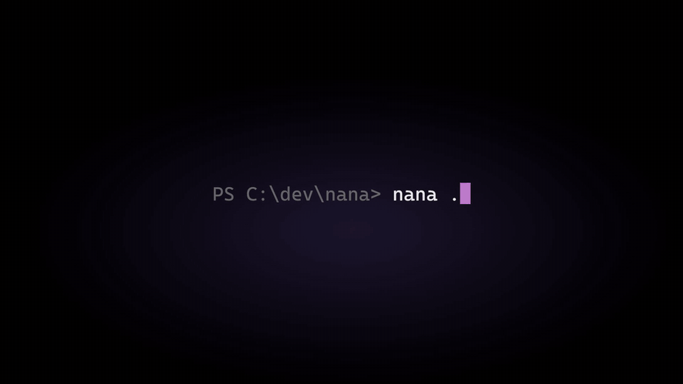

  

<h1 align="center">Nana</h1>

A lightweight, memory-efficient terminal multiplexer for Windows.

<a href="https://nana.areshk.dev">Website</a> | <a href="https://nana.areshk.dev/docs">Docs</a> | <a href="https://github.com/Areshkew/nana/releases">Download</a> | <a href="https://github.com/Areshkew/nana/issues">Issues</a>

This repository is where Nana is released and where you report problems. Nana's
source code is closed and is not published here.

## Features

- Background sessions that keep running when the app is closed
- Remote sessions on Linux and macOS computers over SSH
- Split panes and tabs
- Git: branches, changes, commits, pull requests, worktrees, and stashes
- Code review: read the diffs your agents make, browse past commits, and check
  every change before you commit, without leaving the terminal
- Extensions
- Mobile companion apps for iOS and Android (coming soon)
- AI coding agent integrations
- 490+ themes

## Download

Get the latest version from [Releases](https://github.com/Areshkew/nana/releases):

- `Nana-<version>-x86_64.msi` installs Nana for your user. No administrator
  rights are needed.
- `install-desktop-windows.ps1` installs the same thing from PowerShell.

Nana updates itself after it is installed.

**Requirements:** Windows 10 or newer, x86_64.

## Report a problem

[Open an issue](https://github.com/Areshkew/nana/issues/new/choose). Include
your Nana version (run `nana --version`) and your Windows version. Search the
existing issues first.

## License

Nana is proprietary software. Copyright (c) 2026 Gustavo Ramirez (Areshk).
All rights reserved. See [LICENSE](LICENSE).

The earlier Electron edition of Nana, which was open source under the MIT
License, is kept on the [`electron`](https://github.com/Areshkew/nana/tree/electron)
branch.
